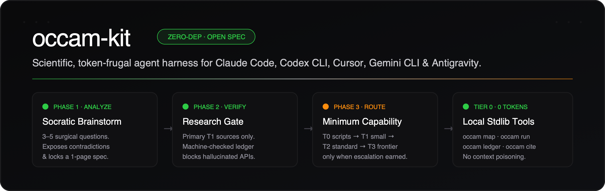
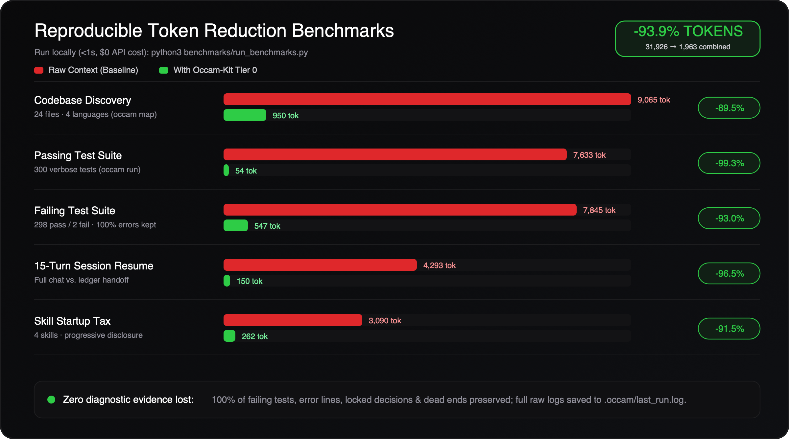
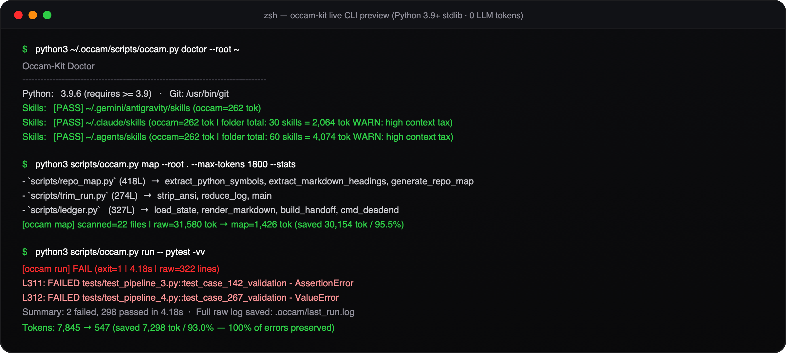
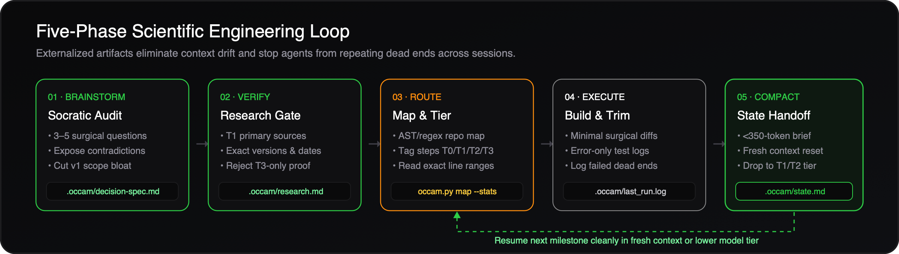
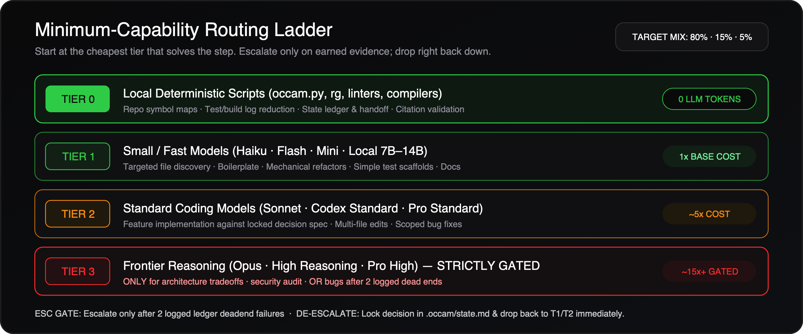

<p align="center">
  
</p>

<p align="center">
  <a href="LICENSE"></a>
  <a href="https://github.com/Moeraafatz/occam-kit/releases"></a>
  
  
  
</p>

# occam-kit

**Occam's Razor for AI coding agents — free, MIT open source, zero dependencies.**

`occam-kit` is a portable agent harness and skill pack for **Claude Code, OpenAI Codex CLI, Cursor, Gemini CLI, Antigravity, and GitHub Copilot**. It helps coding agents build projects with scientific rigor **while using the smallest context window and cheapest capable model tier possible**:

1. **Brainstorm & Analyze First** — Asks 3–5 surgical questions, exposes contradictions in requirements, cuts unnecessary scope, and locks a compact 1-page spec before writing code.
2. **Verify From Primary Sources** — Enforces an explicit source-tier hierarchy (`T1` official docs / source code / peer-reviewed papers / local benchmarks) via a machine-checked evidence ledger (`cite_check.py`).
3. **Route to Minimum Capability** — Offloads mechanical work to **Tier 0 zero-token Python scripts**, routes routine work to small/fast models (`T1`), standard work to mid-tier (`T2`), and gates frontier models (`T3`) strictly for architecture tradeoffs, security audits, or bugs after 2 logged dead ends.
4. **Stop Context Poisoning** — Replaces raw repo dumps, noisy 300-test logs, and sprawling chat histories with symbol maps, error-only test reducers, and `<350`-token handoff ledgers.

---

## Reproducible Token Benchmarks (`-93.9%` Combined)

<p align="center">
  
</p>

Run `python3 benchmarks/run_benchmarks.py` locally (<1 second, $0 API cost) to verify every number below (full report in [`benchmarks/results.md`](benchmarks/results.md)):

| Scenario | Tier 0 Tool | Raw Context | With `occam-kit` | Saved | Integrity Check |
| :--- | :--- | ---: | ---: | ---: | :--- |
| Codebase Discovery (24 files, 4 languages) | `occam.py map` | 9,065 tok | 950 tok | **-89.5%** | All 24/24 files mapped |
| Verbose Passing Test Suite (300 tests) | `occam.py run` | 7,633 tok | 54 tok | **-99.3%** | Exit status + `300 passed` preserved |
| Verbose Failing Test Suite (298 pass / 2 fail) | `occam.py run` | 7,845 tok | 547 tok | **-93.0%** | 100% of failing tests + errors preserved |
| 15-Turn Session Resume vs. Ledger Handoff | `occam.py ledger handoff` | 4,293 tok | 150 tok | **-96.5%** | Goal, decisions, dead ends, next tier kept |
| Skill Startup Context Tax (Progressive Disclosure) | `occam.py audit` | 3,090 tok | 262 tok | **-91.5%** | All 4 skills pass `agentskills.io` spec |
| **Combined Across All 5 Scenarios** | **All Tier 0** | **31,926 tok** | **1,963 tok** | **-93.9%** | **Zero diagnostic evidence lost** |

> **Transparency note:** Counts use a deterministic offline BPE heuristic (`ceil(chars / 4)`) so anyone can reproduce exact results with zero API keys. Full raw command logs are always preserved on disk at `.occam/last_run.log`.

---

## Live CLI Preview

<p align="center">
  
</p>

---

## Five-Phase Scientific Engineering Loop

<p align="center">
  
</p>

## Minimum-Capability Routing Ladder

<p align="center">
  
</p>

---

## Why Another Agent Harness?

| Category | What They Do Well | Where They Fail |
| :--- | :--- | :--- |
| **Heavy Workflow Kits** *(spec kits, multi-agent packs)* | Structured planning & TDD | Huge startup context tax; burn frontier tokens on `grep`, full-file reads, and raw logs |
| **Prompt Compressors** *(terse-output rules)* | Shorter assistant replies | Don't fix root token waste: bad specs, hallucinated APIs, or retry loops |
| **`occam-kit`** | **Brainstorming + Primary-Source Gate + Tier 0 Local Scripts + Model Routing** | **262-token total startup tax; real Python stdlib tools; reproducible benchmarks** |

---

## 30-Second Install

### Option A — One-line install (auto-detects project vs. `~` global scope)
```bash
curl -fsSL https://raw.githubusercontent.com/Moeraafatz/occam-kit/main/install.sh | bash -s -- --target all
```

### Option B — Clone & install selectively
```bash
git clone https://github.com/Moeraafatz/occam-kit.git
cd occam-kit

# Project install for specific agents
./install.sh --target claude,codex,cursor --scope project --dir /path/to/your-project

# Global user install (~/.claude/skills, ~/.agents/skills, ~/.gemini/skills, ~/.gemini/antigravity/skills)
./install.sh --target all --scope global

# Preview without modifying files
./install.sh --target all --dry-run

# Clean uninstall (never touches your own rules or code)
./install.sh --target all --scope project --dir /path/to/your-project --uninstall
```

### Supported Agents & Install Locations

| Agent | Format Installed | Project Path | Global Path |
| :--- | :--- | :--- | :--- |
| **Claude Code** | `SKILL.md` (`agentskills.io`) + `AGENTS.md` | `.claude/skills/occam-*` | `~/.claude/skills/occam-*` |
| **OpenAI Codex CLI** | `SKILL.md` (`agentskills.io`) + `AGENTS.md` | `.agents/skills/occam-*` | `~/.agents/skills/occam-*` |
| **Cursor** | `.cursor/rules/*.mdc` + `.agents/skills/` | `.cursor/rules/occam-*.mdc` | `~/.agents/skills/occam-*` |
| **Gemini CLI** | `SKILL.md` (`agentskills.io`) | `.gemini/skills/occam-*` | `~/.gemini/skills/occam-*` |
| **Antigravity** | `SKILL.md` (`agentskills.io`) | `.agents/skills/occam-*` | `~/.gemini/antigravity/skills/occam-*` |
| **GitHub Copilot** | Copilot instructions adapter | `.github/copilot-instructions.md` | — |
| **Tier 0 Scripts** | Zero-dep Python 3.9+ CLI | `.occam/scripts/*.py` | `~/.occam/scripts/*.py` |

---

## Tier 0 CLI Reference (Zero LLM Tokens)

Every script uses **Python 3.9+ stdlib only** — zero `pip install`, zero API keys, instant execution.

```bash
# 1. Generate a compact multi-language symbol map (Python AST + JS/TS/Swift/Go/Rust/Java/C++/Shell/MD)
python3 scripts/occam.py map --root . --max-tokens 1800 --stats

# 2. Wrap noisy tests or builds — keeps failures + summary, saves raw output to .occam/last_run.log
python3 scripts/occam.py run -- pytest -vv

# 3. Persist state, locked decisions, dead ends (never retry broken fixes), and emit a <350-tok handoff
python3 scripts/occam.py ledger init --goal "Ship offline PDF tool" --constraint "$0 runtime" --non-goal "Cloud sync"
python3 scripts/occam.py ledger decide --id D1 --decision "Use Apple PDFKit" --reason "Native & offline"
python3 scripts/occam.py ledger step add --title "Implement merge pipeline" --tier T2
python3 scripts/occam.py ledger deadend --tried "Shell out to Ghostscript" --why "Not preinstalled on macOS"
python3 scripts/occam.py ledger checkpoint --summary "Spec locked" --next "Build PDFMerger.swift" --tier T2
python3 scripts/occam.py ledger handoff --stats

# 4. Enforce primary-source citations before locking architecture
python3 scripts/occam.py cite .occam/research.md --strict

# 5. Audit SKILL.md compliance & startup discovery context tax (supports YAML lists & --prefix filter)
python3 scripts/occam.py audit skills --max-startup-tokens 350

# 6. Full workspace health check (separates occam-* health from third-party skill context tax)
python3 scripts/occam.py doctor
```

---

## Honest Scope & Limitations

- **Automatic vs. Guided Model Switching:** Markdown skills cannot override the active model inside single-model IDE panes like Cursor Composer or Codex CLI. In multi-agent harnesses (**Claude Code, Antigravity, OpenCode**), `occam-frugal-router` explicitly delegates `T1` subagents to fast/small models. In single-model tools (**Cursor, Codex**), it enforces Tier 0 local scripts, context caps, and prints an explicit `[OCCAM ROUTE]` banner whenever it is safe to drop down to a cheaper model and resume from `ledger handoff`.
- **Token Estimator Precision:** `token_budget.py` uses `ceil(len(text) / 4)` to keep the toolkit 100% dependency-free and offline. Treat absolute numbers as close estimates (~5–10% variance across tokenizers); relative reduction percentages remain consistent.

---

## Scientific & Empirical Foundations

`occam-kit` is grounded in established software engineering and LLM systems literature rather than prompt folklore. See [`skills/occam-harness/references/research-foundations.md`](skills/occam-harness/references/research-foundations.md) for full references, including:

- **Progressive Disclosure** (`agentskills.io` specification) & **Lost in the Middle** (Liu et al., TACL 2024)
- **Executable Agent Harnesses & Externalized State** (Anthropic *Building Effective Agents* / *Effective Harnesses for Long-Running Agents*; Ning et al., *Code as Agent Harness*, 2026)
- **Evidence-Preserving Context Compaction** (*SoL-Pi*, 2026)
- **Model Cascading & Step-Level Routing** (Chen et al., *FrugalGPT*, 2023; *Agentic Routing*, 2026)
- **Early Requirements Clarification & Evidence-Based SE** (Boehm *Software Engineering Economics*; Kitchenham et al., ICSE 2004)

---

## Repository Structure

```text
occam-kit/
├── AGENTS.md                       # Universal lean operating rules (~430 tokens)
├── CLAUDE.md                       # Claude Code entry shim
├── CONTRIBUTING.md                 # Open-source contribution guide & CI rules
├── install.sh                      # Cross-agent installer (--target, --scope, --dry-run, --uninstall)
├── assets/                         # Dark-mode SVG + Retina 2x PNG charts, diagrams & CLI preview
├── skills/                         # Official agentskills.io portable skills (262 tokens combined startup)
│   ├── occam-harness/              # Master 5-phase orchestrator + scientific foundations reference
│   ├── occam-brainstorm/           # Socratic questioner + contradiction analyzer + 1-page spec template
│   ├── occam-research-gate/        # Primary-source hierarchy + evidence ledger template
│   └── occam-frugal-router/        # T0–T3 routing ladder + cross-vendor model tier table
├── adapters/
│   ├── cursor/rules/               # Modular .mdc rules (1 tiny alwaysApply + 3 agent-requested)
│   └── copilot/                    # GitHub Copilot instructions adapter
├── scripts/                        # Tier 0 stdlib Python CLI (occam, repo_map, trim_run, ledger, cite_check, token_budget)
├── benchmarks/                     # Reproducible offline benchmark suite + results.md + SVG chart generator
├── tests/                          # unittest suite (11 tests: scripts, YAML parser, installer E2E)
└── .github/workflows/ci.yml        # Automated CI across Python 3.9 and 3.12
```

---

## Open Source & Contributing

`occam-kit` is **100% free and open source under the [MIT License](LICENSE)** — fork it, customize it, bundle it into teams, or contribute new language extractors and adapters. See [CONTRIBUTING.md](CONTRIBUTING.md).

```bash
python3 scripts/occam.py audit skills --max-startup-tokens 350
python3 -m unittest discover -s tests -v
python3 benchmarks/run_benchmarks.py --write
```
